- [Estudiamos el ejecutable `pe_hello_lab.exe`](#estudiamos-el-ejecutable-pe_hello_labexe)
- [1. File](#1-file)
- [2. Indicators](#2-indicators)
- [3. DOS-Header](#3-dos-header)
- [4. DOS-Stub](#4-dos-stub)
- [5. File-Header](#5-file-header)
- [6. Optional-Header](#6-optional-header)
  - [6.1. Destacamos](#61-destacamos)
  - [6.2. Estructura](#62-estructura)
  - [6.3. Una forma de encontrar dónde está cargado el ejecutable](#63-una-forma-de-encontrar-dónde-está-cargado-el-ejecutable)
  - [6.4. Otra forma de encontrar dónde está cargado el ejecutable](#64-otra-forma-de-encontrar-dónde-está-cargado-el-ejecutable)
  - [6.5 Relación con .text](#65-relación-con-text)
  - [6.6. Directories del Optional Header](#66-directories-del-optional-header)
    - [6.6.1. Import Directory](#661-import-directory)
    - [6.6.2. Exception Directory](#662-exception-directory)
    - [6.6.3. Base Relocation Directory](#663-base-relocation-directory)
    - [6.6.4. TLS Directory](#664-tls-directory)
    - [6.6.5. Import Address Table - IAT](#665-import-address-table---iat)
- [7. Sections](#7-sections)
- [8. Libraries](#8-libraries)
- [9. Imports](#9-imports)
- [10. Overlay](#10-overlay)
- [11. Comparación del PE en disco VS PE cargado en memoria](#11-comparación-del-pe-en-disco-vs-pe-cargado-en-memoria)


-----

## Parte teórica que explica en profundidad los fundamentos PE:
[https://github.com/soniasalido/cybersecurity/blob/main/Documentation/Malware/00-Aprendiendo-Analisis-de-Malware/04-fundamentos-pe/04-fundamentos-pe.md](https://github.com/soniasalido/cybersecurity/blob/main/Documentation/Malware/00-Aprendiendo-Analisis-de-Malware/04-fundamentos-pe/04-fundamentos-pe.md)


------

# Estudiamos el ejecutable `pe_hello_lab.exe`

# 1. File
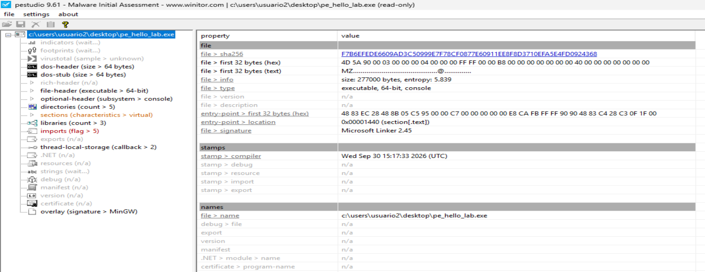

---

# 2. Indicators

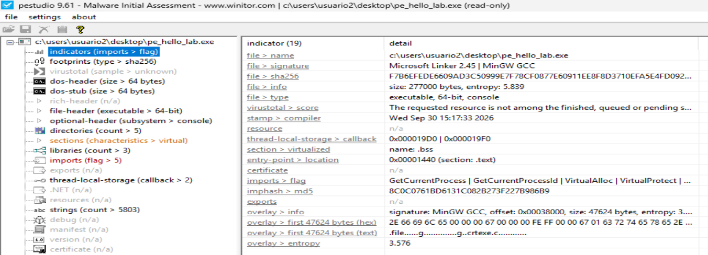

| Elemento | Resultado | Interpretación |
|---|---|---|
| Tipo | `executable, 64-bit, console` |` PE x64` de consola |
| Tamaño | `277000 bytes` | Tamaño total del fichero |
| Entropía | `5.839` | Valor moderado. No sugiere por sí solo empaquetado/cifrado fuerte |
| Toolchain | `MinGW GCC` | Compatible con la forma en que fue compilado |
| Entry Point | `RVA 0x1440`, `.text` | Ubicación normal: el `EP` está dentro de la sección ejecutable |
| TLS callbacks | `0x19D0`, `0x19F0` | Dos `callbacks`, que analizaremos dinámicamente en `x64dbg` |
| `.bss` | `virtualized` | Normal: datos no inicializados que ocupan memoria pero no requieren contenido equivalente en disco |
| Imports destacados | `GetCurrentProcess`, `VirtualAlloc`, `VirtualProtect`, `VirtualQuery` | Coherentes con el laboratorio de inspección/mapeo de memoria local |
| Certificado | `n/a` | El ejecutable no está firmado digitalmente |
| Exports | `n/a` | Normal para este ejecutable; no exporta funciones |
| Resources | `n/a` | No contiene recursos PE relevantes |
| Overlay | `47624 bytes`, MinGW GCC | Compatible con información añadida por la toolchain |
| Overlay entropy | `3.576` | Baja/moderada; no parece contenido cifrado o comprimido |


En conjunto, los metadatos son consistentes con un `PE x64` de consola compilado con `MinGW`, no firmado, con estructura convencional y funciones de gestión de memoria introducidas deliberadamente para el laboratorio.

---

# 3. DOS-Header

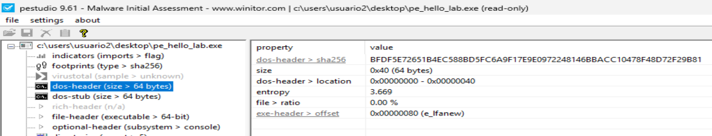


Observamos que los primeros elementos estructurales de este archivo `pe_hello_lab.c` corresponde a:
- `4D 5A` = `MZ`. Esto identifica el inicio del `DOS Header`.
- `IMAGE_DOS_HEADER` ocupa: 64 bytes
- Se encuentra en: `0x00000000 - 0x00000040`
- También observamos el campo: `e_lfanew = 0x80`. Este valor indica que las `cabeceras PE/NT` comienzan en el offset: `0x00000080`.

**Identificamos en `x64dbg` estos elementos estructurales del ejecutable:**
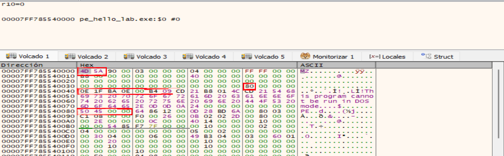


**Nota sobre:** Para entender estos cálculos es necesario conocer cómo sabemos `MappedBase`: [  ➞ Ir ➞ ](#61-destacamos)

```
MappedBase = 0x00007FF785540000
           + 0x00000000
           --------------------
Dos-Header = 0x00007FF785540000
```

```
MappedBase
0x7FF785540000
        │
        ▼
+0x00
4D 5A
 │
 └── "MZ"

        ...

+0x3C
80 00 00 00
 │
 └── e_lfanew = 0x80
                  │
                  ▼
MappedBase + 0x80
                  │
                  ▼
0x7FF785540080 =  50 45 00 00 = PE\0\0 
```

Se distinguen perfectamente las tres primeras zonas:
```
0x7FF785540000
┌────────────────────────────┐
│ IMAGE_DOS_HEADER           │
│                            │
│ 4D 5A → MZ                 │
│                            │
│ +0x3C                      │
│ e_lfanew = 0x80            │
└────────────────────────────┘
             │
             ▼
0x7FF785540040
┌────────────────────────────┐
│ DOS Stub                   │
│                            │
│ "This program cannot be    │
│  run in DOS mode."         │
└────────────────────────────┘
             │
             ▼
0x7FF785540080
┌────────────────────────────┐
│ NT Headers                 │
│                            │
│ 50 45 00 00                │
│ PE\0\0                     │
└────────────────────────────┘
```

**Localización de las NT Headers mediante e_lfanew.** El campo `e_lfanew`, situado en el `offset 0x3C` del `IMAGE_DOS_HEADER`, contiene el valor `0x80`. Al sumar este desplazamiento a la base del módulo (`0x7FF785540000`) se obtiene `0x7FF785540080`, dirección en la que se encuentra la firma `50 45 00 00`, correspondiente a `PE\0\0`. Esto confirma cómo el `DOS Header` permite localizar las `cabeceras NT` del ejecutable.

---

# 4. DOS-Stub

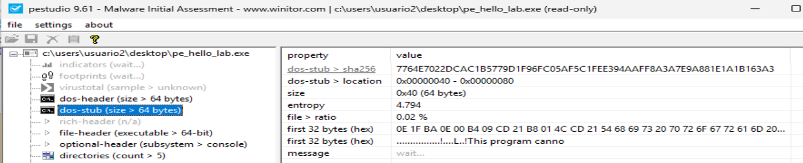

El `DOS Stub` de este ejecutable ocupa exactamente `0x40 bytes` (64 bytes), desde el offset `0x40` hasta `0x80`, justo entre el `IMAGE_DOS_HEADER` y las `cabeceras NT` señaladas por `e_lfanew`.

En resumen, en este ejecutable el `DOS Stub` es convencional y no presenta nada especialmente anómalo: ocupa la región entre el `DOS Header` y las `NT` Headers y contiene el mensaje clásico de incompatibilidad con `DOS`.

**Identificamos en `x64dbg` el `Dos-Stub`:**
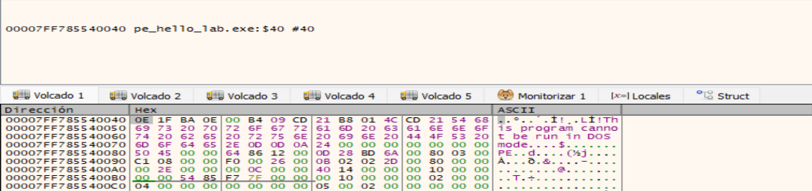
```
MappedBase = 0x00007FF785540000
           + 0x00000040
           --------------------
Dos-Stub  =  00007FF785540040
```

---

# 5. File-Header
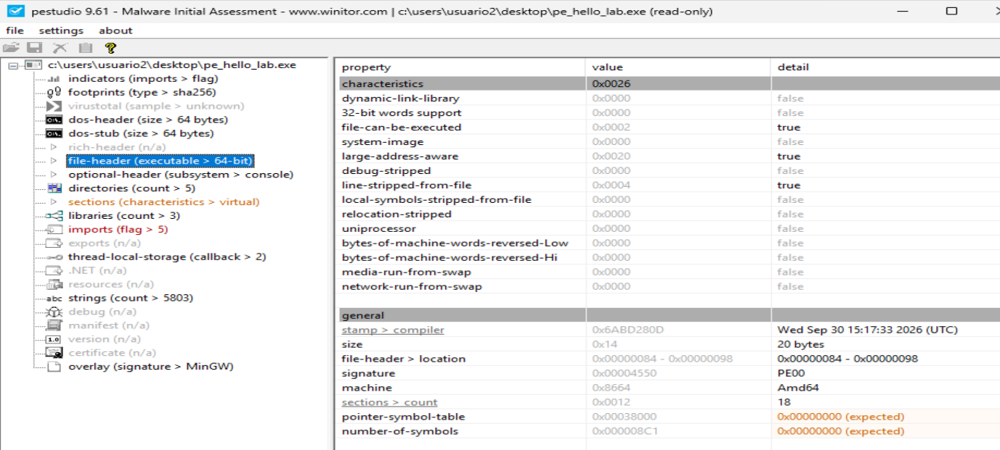

Destacamos:
```
Offset 0x80
        │
        ▼
┌───────────────────────────────┐
│ PE Signature                  │
│                               │
│ PE\0\0                        │
└───────────────────────────────┘
        │
        ▼
Offset 0x84
┌───────────────────────────────┐
│ IMAGE_FILE_HEADER             │
│ tamaño = 20 bytes             │
│                               │
│ Machine          = AMD64      │
│ Sections         = 18         │
│ Characteristics  = 0x0026     │
│   ├── Ejecutable              │
│   ├── Large Address Aware     │
│   ├── No es DLL               │
│   ├── Relocations disponibles │
│                               │
│ TimeDateStamp    = 0x6ABD280D │
└───────────────────────────────┘
        │
        ▼
Offset 0x98
┌───────────────────────────────┐
│ IMAGE_OPTIONAL_HEADER         │
│ ...                           │
└───────────────────────────────┘
```

Esta información confirma que `pe_hello_lab.exe` es una imagen `PE` ejecutable de `64 bits` y nos proporciona los metadatos básicos necesarios antes de pasar al `IMAGE_OPTIONAL_HEADER`.

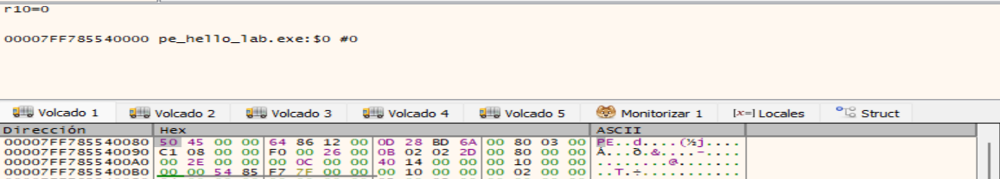

```
MappedBase    = 0x00007FF785540000
              + 0x00000080
              --------------------
pe-signature  =  00007FF785540080
```

---

# 6. Optional-Header
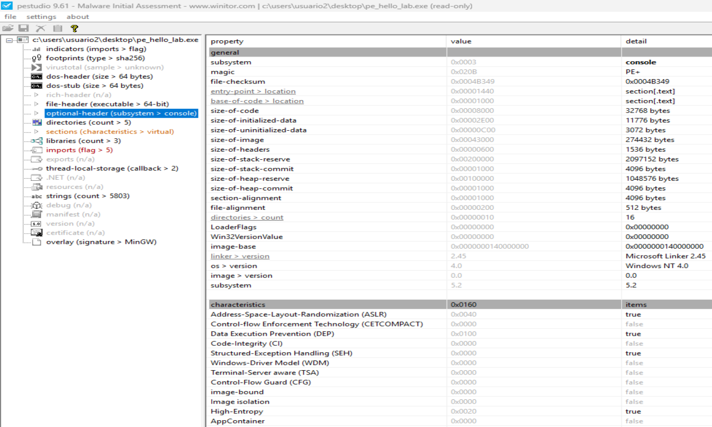


## 6.1. Destacamos
- Se confirma que se trata de una imagen `PE32+ de 64 bits`, ya que presenta: `Magic = 0x020B` & `PE32+`.
- El ejecutable está configurado como aplicación de consola: `Subsystem = 0x0003`. `Console`.
- Punto de entrada (RVA de inicio): `AddressOfEntryPoint = 0x00001440`.
- La herramienta indica que esta `RVA` se encuentra dentro de la sección: `.text`.
- El código comienza en: `BaseOfCode = 0x00001000`.
- La dirección base preferida es: `ImageBase = 0x0000000140000000`
- `VA = ImageBase + RVA`.
- El punto de entrada correspondería conceptualmente a:
  ```
  0x140000000
  +     0x1440
  ----------------
  0x140001440
  ```
- Si la imagen se carga en su `ImageBase` preferido = `0x140001440`.


## 6.2. Estructura
```
ImageBase
0x0000000140000000
        │
        ▼
RVA 0x0000
+-----------------------------+
| Headers                     |
| SizeOfHeaders = 0x600       |
+-----------------------------+
        │
        │ espacio/alineamiento
        │
        ▼
RVA 0x1000 ← inicio de la sección / BaseOfCode
+----------------------------------+
| .text                            |
| BaseOfCode                       |
|    ...                           |
|    ...                           |
| RVA 0x1440 ← AddressOfEntryPoint |
| EntryPoint                       |
+----------------------------------+
```

Tenemos que `.text` comienza en: `ImageBase + 0x1000 = 0x140001000`.

Mientras que el `Entry Point` está más adelante dentro de `.text`: `ImageBase + 0x1440 = 0x140001440`.


**Nota interesante:**  
Es importante observar que: `SizeOfHeaders = 0x600`. Pero la primera sección empieza en: `RVA 0x1000`. Debido principalmente al: `SectionAlignment = 0x1000`, entre `RVA 0x600` y: `RVA 0x1000` hay una zona de alineamiento. Esa distinción será muy útil cuando comparemos `PE en disco` frente a `PE en memoria`.


## 6.3. Una forma de encontrar dónde está cargado el ejecutable
Vemos con `x64dbg` el Address of Entry Point:  
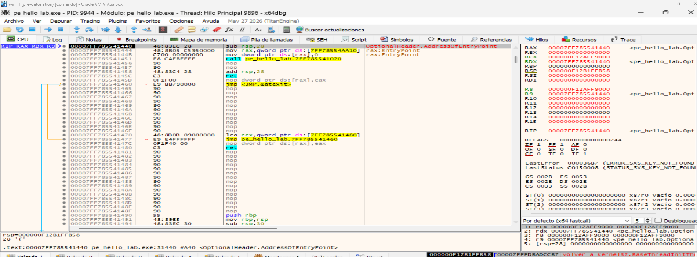


En la parte inferior x64dbg se observa:
```
.text:00007FF785541440
pe_hello_lab.exe:$1440
<OptionalHeader.AddressOfEntryPoint>
```

Esto coincide exactamente con el valor que habíamos obtenido del Optional Header: `AddressOfEntryPoint = RVA 0x1440`.

Por tanto:
```
RVA del Entry Point = 0x1440
```

y en esta ejecución concreta su dirección virtual es:
```
VA del Entry Point
        =
0x00007FF785541440
```

El registro `RIP` confirma además que la CPU está detenida precisamente en esa instrucción: `RIP = 00007FF785541440`.

Podemos calcular la base real de carga: Sabemos que: `VA = MappedBase + RVA`.

**<mark>por tanto: `MappedBase = VA - RVA`.</mark>**

Aplicándolo:
```
0x00007FF785541440
-
0x0000000000001440
────────────────────
0x00007FF785540000
```

Así que el ejecutable se encuentra realmente cargado en: `MappedBase = 0x00007FF785540000`.


## 6.4. Otra forma de encontrar dónde está cargado el ejecutable
Mucho más sencillo es observar el detalle del mapa de memoria que también nos indica la dirección en donde se ha cargado el ejecutable:
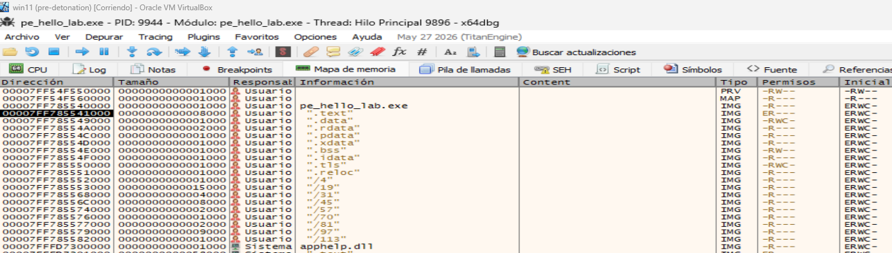
donde:
- Vemos que la línea correspondiente a `pe_hello_lab.exe` tiene la dirección: `0x00007FF785540000`

Esto es importante porque en el análisis estático habíamos visto: `ImageBase preferida = 0x0000000140000000`.

pero durante esta ejecución tenemos:
```
ImageBase preferida
0x0000000140000000

           ≠

MappedBase real
0x00007FF785540000
```

**<mark>Esto es un ejemplo perfecto del efecto de ASLR.</mark>** El `AddressOfEntryPoint = 0x1440` obtenido del `Optional Header` es una `RVA`. `x64dbg` la convierte en una dirección efectiva al sumarla a la base real donde **ASLR** ha cargado el módulo.


**ASLR** = Address Space Layout Randomization. Aleatorización del diseño/distribución del espacio de direcciones. Su objetivo es cargar ejecutables y bibliotecas en direcciones de memoria variables entre ejecuciones, dificultando que un atacante pueda predecir direcciones concretas.


----

## 6.5 Relación con .text

También habíamos visto:
```
.text VirtualAddress = RVA 0x1000
```
Por tanto, en esta ejecución `.text` comienza aproximadamente en:
```
MappedBase + 0x1000

0x00007FF785540000
+             1000
────────────────────
0x00007FF785541000
```

Y el Entry Point está en:
```
0x00007FF785541440
```

Es decir:
```
MappedBase
0x7FF785540000
       │
       ▼

RVA 0x1000
0x7FF785541000
┌──────────────────────────────┐
│ .text                        │
│                              │
│ ...                          │
│                              │
│ +0x440                       │
│                              │
│ EntryPoint                   │
│ 0x7FF785541440               │
└──────────────────────────────┘
```

Esto confirma experimentalmente lo que explicábamos en teoría:
- `dirección de una sección = MappedBase + VirtualAddress`, y
- `EntryPoint = MappedBase + AddressOfEntryPoint`.


---

## 6.6. Directories del Optional Header
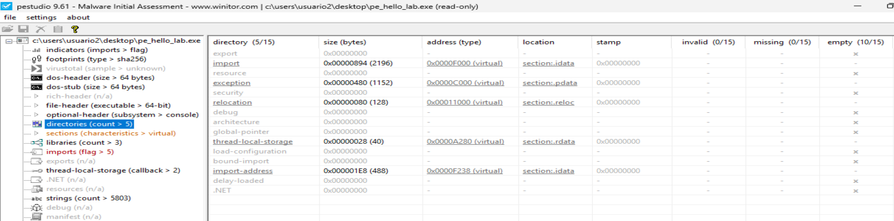


La tabla de `Data Directories` del `Optional Header` indica qué estructuras adicionales utiliza el `PE` y en qué `RVA` se encuentran. Las más relevantes son:


### 6.6.1. Import Directory

**Import Directory:** Esta entrada contiene la información necesaria para localizar las `DLL` y funciones importadas por el ejecutable.
- RVA  = 0x0000F000
- Size = 0x894
- Section = .idata

**Detalle del Import Directory en x64dbg:**
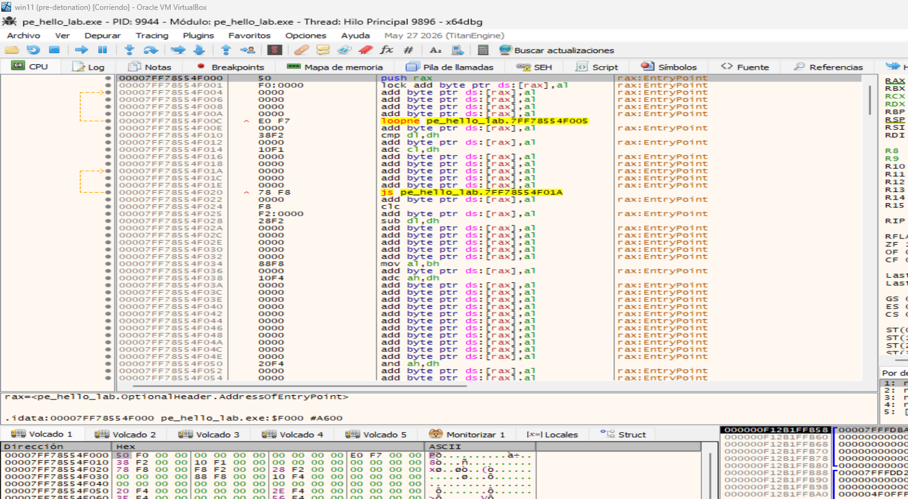

- La dirección virtual del Import Directory es:
  ```
  0x00007FF785540000
  +           0xF000
  ──────────────────────
  0x00007FF78554F000
  ```
- Inicio del Import Directory en memoria: La `RVA 0xF000` indicada por el `Data Directory` se traduce, al sumarla a la base real del módulo `0x7FF785540000`, en la dirección virtual `0x7FF78554F000`. x64dbg confirma que esta dirección pertenece a la sección `.idata`. Los primeros 20 bytes corresponden al primer `IMAGE_IMPORT_DESCRIPTOR`. Entre sus campos puede observarse `FirstThunk = 0xF238`, coincidente con la `RVA` de la `Import Address Table` obtenida durante el análisis estático.
  
- Vamos aseguir el campo: `Name = RVA 0xF7E0`. Ahí veremos qué `DLL` describe este primer `IMAGE_IMPORT_DESCRIPTOR`.
  ```
  MappedBase = 0x00007FF785540000
  IAT RVA    = 0x000000000000F238
               ──────────────────
  IAT VA     = 0x00007FF78554F238
  ```
  - En el panel Dump, pulsamos `Ctrl+G`: `pe_hello_lab.exe+F238`.
  - En el Dump vemos entradas de la Import Address Table:
    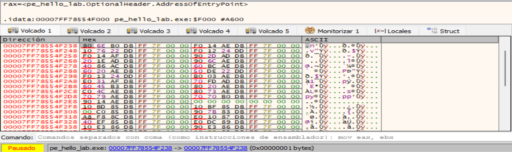
  - Como el ejecutable es `x64` cada entrada de la IAT ocupa: `8 bytes = 1 QWORD`.
  - Los primeros 8 bytes son: `80 6E B0 DB FF 7F 00 00`.
  - Como Windows/x86-64 utiliza `little-endian`, se interpretan como: `0x00007FFFDBB06E80` ──► API importada.
  - Seleccionamos estos 8 bytes ──► clic derecho  ──► `Follow QWORD in Disassembler`:
    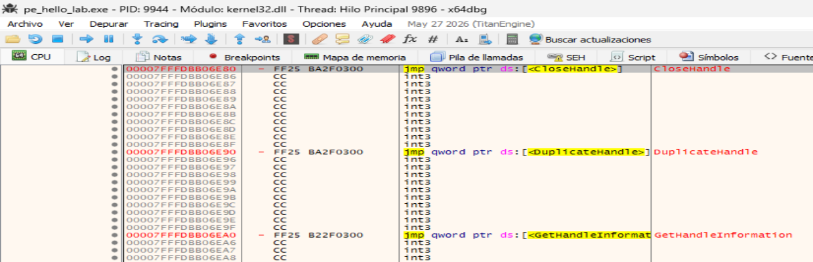
- Al seguir uno de los `QWORD` almacenados en la Import Address Table mediante `Follow QWORD in Disassembler`, x64dbg conduce a una dirección perteneciente a `kernel32.dll`. En este caso puede observarse la `API CloseHandle`, junto con otros exports como `DuplicateHandle` y `GetHandleInformation`. Esto demuestra que, una vez cargado el proceso, las entradas de la `IAT` contienen direcciones virtuales resueltas de las funciones importadas.


```
Optional Header
      │
      ▼
Import Directory
RVA 0xF000
      │
      ▼
IMAGE_IMPORT_DESCRIPTOR
      │
      ├── DLL
      ├── INT
      │
      └── FirstThunk = 0xF238
                         │
                         ▼
                    IAT RVA 0xF238
                         │
                         ▼
                 0x7FF78554F238
                         │
                         ▼
                direcciones reales
                    de las APIs
```

**Resumiendo:** `Import Address Table` en memoria. La `IAT` comienza en la `RVA 0xF238`, que al sumarse a la base real del módulo (`0x7FF785540000`) corresponde a la `VA 0x7FF78554F238`. Al tratarse de un ejecutable `x64`, cada entrada ocupa 8 bytes. Una vez cargado el proceso, estas entradas contienen direcciones virtuales de las funciones importadas resueltas por el loader de Windows.

----

### 6.6.2. Exception Directory

- **Exception Directory:** En ejecutables `x64`, `.pdata` suele contener información utilizada para el manejo de excepciones y para el `stack unwinding`.
  - RVA  = 0x0000C000
  - Size = 0x480
  - Section = .pdata

----

### 6.6.3. Base Relocation Directory

- **Base Relocation Directory:** Esta tabla contiene la información necesaria para corregir determinadas direcciones si el ejecutable no puede cargarse en su `ImageBase` preferido.
  - RVA  = 0x00011000
  - Size = 0x80
  - Section = .reloc
  - ImageBase = 0x140000000
  - Conceptualmente: `Delta = ActualBase - PreferredImageBase`.
  - Esto es especialmente relevante para el posterior estudio de `PE Injection / Manual Mapping`.
  - MappedBase             = 0x00007FF785540000
  - Base Relocation RVA    = 0x00011000
  - La dirección real es:
    ```
    0x00007FF785540000
    +          0x11000
    ──────────────────────
    0x00007FF785551000
    ```
    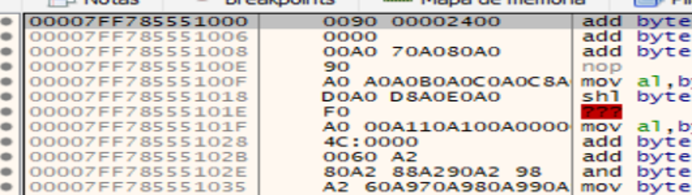
    
    Vemos en la captura:
    ```
    .reloc:00007FF785551000
  	pe_hello_lab.exe:$11000

    00 90 00 00  -> VirtualAddress = 0x00009000
    24 00 00 00  -> SizeOfBlock    = 0x00000024
    ```
  - El funcionamiento completo de `.reloc` queda así:
    ```
    .reloc
    RVA 0x11000
             │
             ▼
    ┌──────────────────────────────┐
    │ IMAGE_BASE_RELOCATION        │
    │                              │
    │ VirtualAddress = 0x9000      │
    │ SizeOfBlock    = 0x24        │
    ├──────────────────────────────┤
    │ WORD relocation #1           │
    │ WORD relocation #2           │
    │ WORD relocation #3           │
    │ ...                          │
    └──────────────────────────────┘
    ```

  - Y estas entradas permiten corregir direcciones cuando ocurre justamente lo que estamos viendo en la ejecución:
    ```
    ImageBase preferida:
    
    0x0000000140000000
    
              ≠
    
    MappedBase real:
    
    0x00007FF785540000
    ```
  - Por lo tanto hay un desplazamiento:
    ```
    Delta =
    MappedBase - ImageBase preferida
    ```
    que el cargador utiliza junto con `.reloc` para corregir las referencias afectadas.

  - `Base Relocation Directory` en memoria: La `RVA 0x11000` se traduce en la dirección virtual `0x7FF785551000` al sumarla a la base real del módulo. Esta dirección pertenece a la sección `.reloc`. Los primeros 8 bytes forman una estructura `IMAGE_BASE_RELOCATION`: `VirtualAddress = 0x9000` y `SizeOfBlock = 0x24`. A continuación aparecen las entradas que identifican las posiciones que deben corregirse cuando la imagen se carga en una dirección diferente de su `ImageBase` preferido.
  - Debemos ignorar las supuestas instrucciones `add byte ptr...` de la ventana CPU en esta zona. Son simplemente el resultado de que `x64dbg` está desensamblando datos de `.reloc` como si fueran código.

-------


### 6.6.4. TLS Directory

**TLS Directory:** Contiene información sobre el almacenamiento local de hilos (Thread Local Storage, TLS) y puede definir funciones de inicialización llamadas **TLS callbacks.** Estas funciones son relevantes para el análisis porque pueden ejecutarse antes del punto de entrada del ejecutable, lo que **permite al malware realizar acciones tempranas** que podrían pasar inadvertidas si la depuración comienza directamente en el `Entry Point`.
- RVA  = 0x0000A280
- Size = 0x28
- Section = .rdata
```
MappedBase        = 0x00007FF785540000
TLS Directory RVA = 0x0000A280

Por tanto:
0x00007FF785540000
+           0xA280
──────────────────────
0x00007FF78554A280
```

Estructura:
```
IMAGE_TLS_DIRECTORY64
{
    ULONGLONG StartAddressOfRawData;
    ULONGLONG EndAddressOfRawData;
    ULONGLONG AddressOfIndex;
    ULONGLONG AddressOfCallBacks;
    DWORD     SizeOfZeroFill;
    DWORD     Characteristics;
};
```

Vemos en el DUMP:  
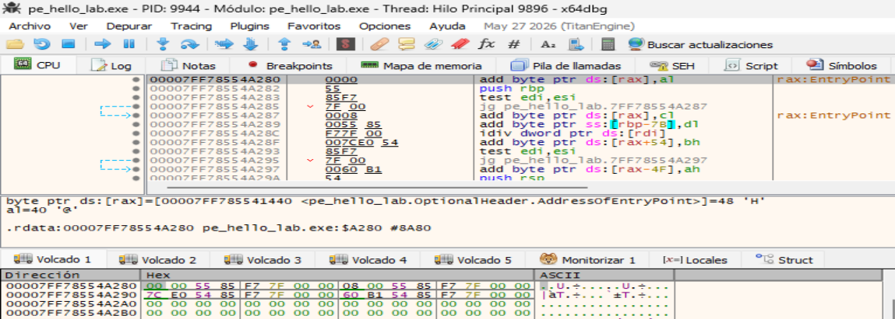

| Dirección | Bytes | Campo | Valor interpretado |
|---|---|---|---|
| `7FF78554A280` | `00 00 55 85 F7 7F 00 00` | `StartAddressOfRawData` | `0x00007FF785550000` |
| `7FF78554A288` | `08 00 55 85 F7 7F 00 00` | `EndAddressOfRawData` | `0x00007FF785550008` |
| `7FF78554A290` | `7C E0 54 85 F7 7F 00 00` | `AddressOfIndex` | `0x00007FF78554E07C` |
| `7FF78554A298` | `60 B1 54 85 F7 7F 00 00` | `AddressOfCallBacks` | `0x00007FF78554B160` |
| `7FF78554A2A0` | `00 00 00 00` | `SizeOfZeroFill` | `0` |
| `7FF78554A2A4` | `00 00 00 00` | `Characteristics` | `0` |

- El campo más interesante es **AddressOfCallBacks**. El ejecutable tiene: `00007FF78554B160`.
  ```
  TLS Directory

        7FF78554A298
             │
             │ contiene:
             ▼
        7FF78554B160
             │
             ▼
        array de punteros
        a TLS callbacks
  ```
- En `7FF78554B160` podemos comprobar si existen `callbacks`.
- En el panel Dump: `Ctrl + G`, escribimos: `00007FF78554B160`:
  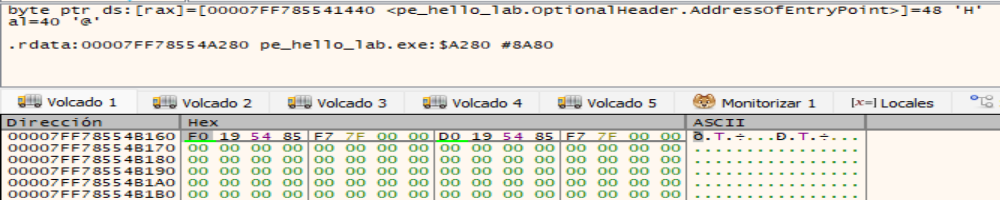

  Como estamos en x64, cada entrada es un QWORD de 8 bytes y debe interpretarse en little-endian:
  
  | Dirección del array | Bytes | Valor | Significado |
  |---|---|---|---|
  | `0x7FF78554B160` | `F0 19 54 85 F7 7F 00 00` | `0x7FF7855419F0` | TLS Callback 1 |
  | `0x7FF78554B168` | `D0 19 54 85 F7 7F 00 00` | `0x7FF7855419D0` | TLS Callback 2 |
  | `0x7FF78554B170` | `00 00 00 00 00 00 00 00` | `NULL` | Fin del array |

- **Array de TLS callbacks.** El campo `AddressOfCallBacks` del `IMAGE_TLS_DIRECTORY64` apunta a `0x7FF78554B160`. En esta dirección se observa un array de dos punteros, `0x7FF7855419F0` y `0x7FF7855419D0`, seguido por una entrada `NULL` que marca el final. Al restar la base del módulo se obtienen las `RVA 0x19F0` y `0x19D0`, ambas situadas dentro de la sección `.text`.

- **Callback 1:** Siguiendo el primer puntero del array `AddressOfCallBacks`, `x64dbg` conduce a `0x7FF7855419F0`, correspondiente a la `RVA 0x19F0` dentro de `.text`. La rutina examina el parámetro `Reason` recibido en `EDX`, comportamiento coherente con una función `TLS` utilizada durante eventos de inicialización del proceso o de los hilos. En este ejecutable, el callback parece formar parte del runtime generado por `MinGW`.
  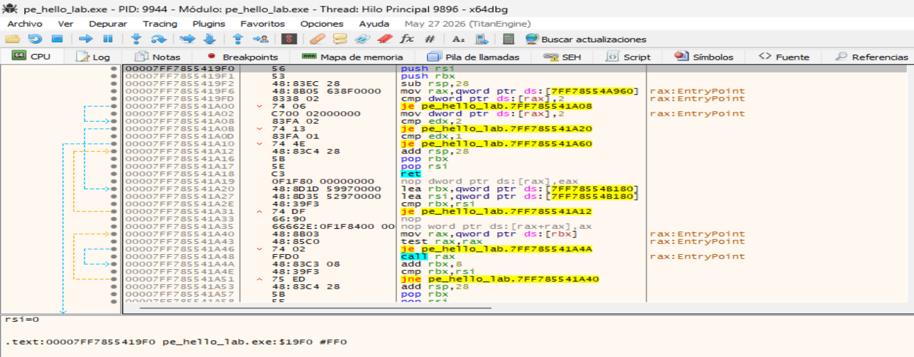  

- **Callback 2:** El segundo elemento del array `AddressOfCallBacks` apunta a `0x7FF7855419D0`, correspondiente a la `RVA 0x19D0` dentro de `.text`. La rutina examina el parámetro `Reason` recibido en `EDX` y actúa específicamente ante los valores `0` (`DLL_PROCESS_DETACH`) y `3` (`DLL_THREAD_DETACH`), lo que sugiere una función relacionada con tareas de finalización o limpieza del runtime.
  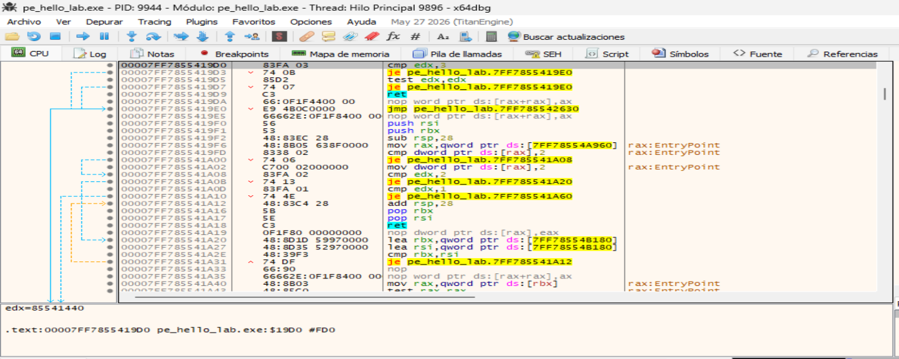  

----

### 6.6.5. Import Address Table - IAT

**Import Address Table (IAT):** La `IAT` contiene las direcciones de las funciones importadas una vez resueltas por el cargador.
- RVA  = 0x0000F238
- Size = 0x1E8
- Section = .idata
  ```
  MappedBase = 0x00007FF785540000
  IAT RVA    = 0x0000F238
  IAT Size   = 0x000001E8
  Section    = .idata

  Por tanto:
  0x00007FF785540000
  +             0xF238
  ──────────────────────
  0x00007FF78554F238
  ```

  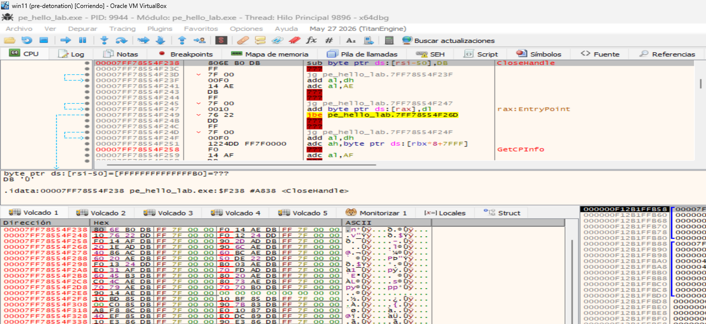

- Los primeros `8 bytes` son: `80 6E B0 DB FF 7F 00 00`.
- Como estamos en `x64` y los valores están almacenados en little-endian, corresponden a: `0x00007FFFDBB06E80`.
- `x64dbg` identifica esa dirección como: `CloseHandle`.

La `IAT` comienza en la `RVA 0xF238`, que corresponde a la dirección virtual `0x7FF78554F238` dentro de `.idata`. Al tratarse de un `PE x64`, cada entrada ocupa `8 bytes`. La primera entrada contiene la dirección `0x7FFFDBB06E30`, que `x64dbg` resuelve como `CloseHandle`, demostrando que el cargador de Windows ya ha sustituido los `thunks` por las direcciones virtuales de las funciones importadas.


Para **PE Injection**, destacan especialmente **Import Directory + IAT + Base Relocation Directory**, porque son estructuras que deben tenerse en cuenta cuando una imagen `PE` se reconstruye manualmente en memoria.


---

# 7. Sections

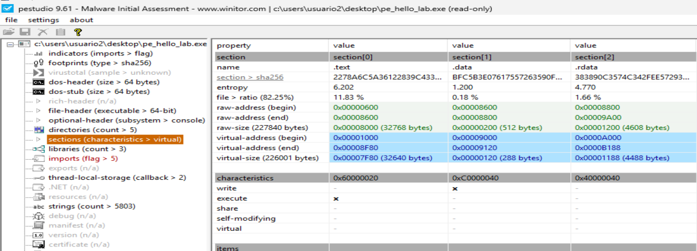

| Sección | RVA inicial | Raw Offset | Virtual Size | Raw Size | Permisos | Función / relevancia |
|---|---:|---:|---:|---:|:---:|---|
| **`.text`** | `0x1000` | `0x600` | `0x7F80` | `0x8000` | `R-X` | Código ejecutable. Contiene `BaseOfCode` y el **Entry Point (`RVA 0x1440`)**. |
| **`.data`** | `0x9000` | `0x8600` | `0x120` | `0x200` | `RW-` | Variables y datos inicializados modificables. |
| **`.rdata`** | `0xA000` | `0x8800` | `0x1188` | `0x1200` | `R--` | Datos de solo lectura. Contiene el **TLS Directory en `RVA 0xA280`**. |
| **`.pdata`** | `0xC000` | `0x9A00` | `0x480` | `0x600` | `R--` | Información de excepciones/*unwind* en x64. Contiene el **Exception Directory**. |
| **`.xdata`** | `0xD000` | `0xA000` | `0x404` | `0x600` | `R--` | Datos auxiliares relacionados con excepciones y *stack unwinding*. |
| **`.bss`** | `0xE000` | — | `0xB90` | `0` | `RW-` | Datos no inicializados. Es un ejemplo claro de una sección que ocupa memoria pero no datos físicos en disco. |
| **`.idata`** | `0xF000` | `0xA600` | `0x894` | `0xA00` | `R--` | Información de importaciones. Contiene **Import Directory (`0xF000`)** e **IAT (`0xF238`)**. |
| **`.tls`** | `0x10000` | `0xB000` | `0x10` | `0x200` | `RW-` | Datos de Thread Local Storage. |
| **`.reloc`** | `0x11000` | `0xB200` | `0x80` | `0x200` | `R--` | Contiene las **base relocations**, necesarias si cambia la base de carga. |


Diferencia entre disco y memoria:
| Sección | En disco (`PointerToRawData`) | En memoria (`VirtualAddress`) |
|---|---:|---:|
| `.text` | `0x600` | `0x1000` |
| `.data` | `0x8600` | `0x9000` |
| `.rdata` | `0x8800` | `0xA000` |
| `.pdata` | `0x9A00` | `0xC000` |
| `.idata` | `0xA600` | `0xF000` |
| `.reloc` | `0xB200` | `0x11000` |

Relación más importante para PE Injection:
```
.text
  │
  └── Código + EntryPoint
          RVA 0x1440

.idata
  │
  ├── Import Directory
  └── IAT

.reloc
  │
  └── Correcciones por cambio
      de ImageBase

.rdata
  │
  └── TLS Directory
```

**Mapa de memoria y permisos de las secciones:** Vemos la imagen `PE` mapeada por el sistema:  
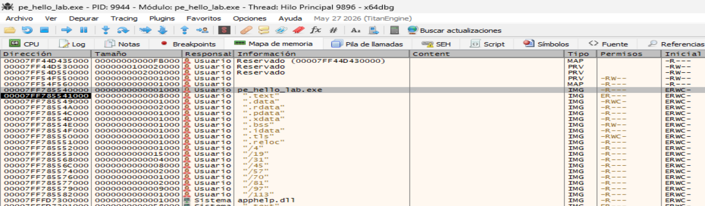

Los permisos que se observan son coherentes con un `PE` normal. No se aprecia ninguna sección principal con permisos simultáneos de escritura y ejecución (`RWX`). Si encontraramos zonas como:
```
.text → RWX
.data → RWX
```
tendríamos que hacer una investigación porque permitiría modificar y ejecutar código en la misma región. No sería prueba de malware por sí sola, pero sí un indicador que justificaría investigar más.


----

# 8. Libraries

```
KERNEL32.dll,-,Implicit,23,Windows NT BASE API Client
msvcrt.dll,-,Implicit,34,Microsoft C Runtime Library
USER32.dll,-,Implicit,1,Multi-User Windows USER API Client Library
```

Este ejecutable importa de forma implícita tres bibliotecas del sistema:
| Biblioteca | Tipo | Nº de imports | Función principal |
|---|---|---:|---|
| `KERNEL32.dll` | Implicit | 23 | API base de Windows: procesos, memoria, archivos, hilos, sincronización, etc. |
| `msvcrt.dll` | Implicit | 34 | Microsoft C Runtime: funciones estándar de C utilizadas por el programa. |
| `USER32.dll` | Implicit | 1 | API gráfica de Windows; en este laboratorio se utiliza para `MessageBoxA`. |


# 9. Imports

```
GetCurrentProcess,x,implicit,-,0x00000000,0x00000000,KERNEL32.dll
GetCurrentProcessId,x,implicit,-,0x00000000,0x00000000,KERNEL32.dll
VirtualAlloc,x,implicit,-,0x00000000,0x00000000,KERNEL32.dll
VirtualProtect,x,implicit,-,0x00000000,0x00000000,KERNEL32.dll
VirtualQuery,x,implicit,-,0x00000000,0x00000000,KERNEL32.dll
...
...
```

Vemos el detalle de algunos de los imports que usa este ejecutable.
```
GetCurrentProcess
        │
        ▼
proceso actual
        │
        ├── VirtualAlloc
        │      └── reservar memoria
        │
        ├── VirtualProtect
        │      └── cambiar permisos
        │
        └── VirtualQuery
               └── inspeccionar memoria
```

# 10. Overlay

```
overlay > sha256,FB765A30C3559ACB5506F2AC2F02B8FEC48484FF25CF28893BF9F8976D135403
entropy,3.576
overlay > location,0x00038000 - 0x00043A08
size,0xBA08 (47624 bytes)
signature,MinGW GCC
first 32 bytes (hex),2E 66 69 6C 65 00 00 00 67 00 00 00 FE FF 00 00 67 01 63 72 74 65 78 65 2E 63 00 00 00 00 00 00 
first 32 bytes (text),.file......g..............g..crtexe.c............
file > ratio,17.19 %
```

El overlay es la información situada después del final lógico de las secciones PE. En este ejecutable, el overlay no parece sospechoso por sí mismo: los datos mostrados son compatibles con artefactos de compilación de `MinGW/GCC`. Para análisis de malware, sin embargo, el overlay siempre merece revisión porque también puede utilizarse para almacenar configuraciones, payloads, datos comprimidos o contenido añadido al PE que no pertenece a ninguna sección.


-------------

# 11. Comparación del PE en disco VS PE cargado en memoria

```
PE EN DISCO

FileBase + PointerToRawData
              │
              │ memcpy
              ▼
PE RECONSTRUIDO EN MEMORIA

MappedBase + VirtualAddress
```

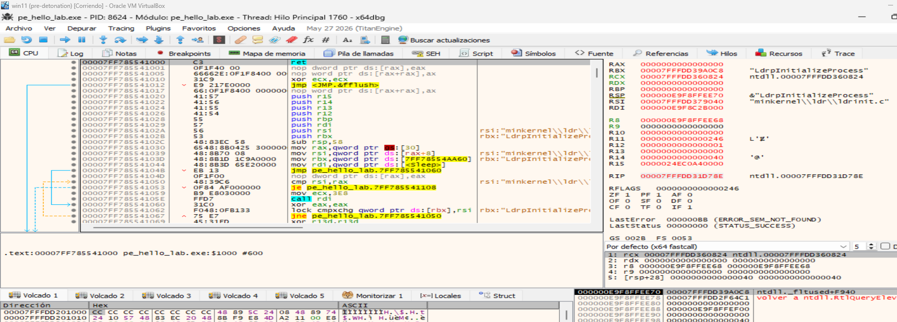

Comparativa con la sección `.text` para ver la diferencia entre `PointerToRawData` y `VirtualAddress`:
```
PE EN DISCO                    PE EN MEMORIA

PointerToRawData              VirtualAddress
     0x600                       RVA 0x1000
       │                            │
       │                            │
       ▼                            ▼
bytes de .text      →      0x7FF785541000
```

La sección `.text` se encuentra en el `offset 0x600` dentro del archivo `PE`, pero una vez cargada por Windows queda situada en la `RVA 0x1000`. Con una base de carga `0x7FF785540000`, su dirección virtual es `0x7FF785541000`. `x64dbg` muestra simultáneamente estos valores como `.text:0x7FF785541000, $1000 y #600`.


La presencia de un `ret` en `0x7FF785541000` no contradice en absoluto que sea el inicio de `.text`. Una sección `PE` es un contenedor de código, no una función ni el punto inicial de ejecución.

--------


