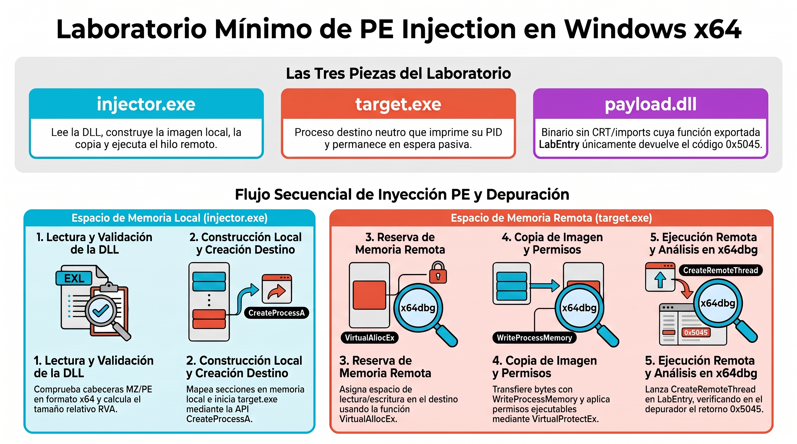

# Laboratorio básico de PE Injection en Windows x64

Laboratorio práctico para observar cómo un inyector prepara una `DLL` en memoria, la copia a un proceso destino creado por él mismo y ejecuta una de sus funciones mediante un hilo remoto.

La práctica utiliza `x64dbg` para seguir las operaciones y comprobar sus argumentos, direcciones y resultados.

## Objetivos
- Distinguir la distribución de un `PE` en disco y en memoria.
- Identificar las cabeceras y secciones de una `DLL`.
- Diferenciar las asignaciones de memoria locales y remotas.
- Observar la transferencia de la imagen al destino y sus permisos.
- Seguir la ejecución de `LabEntry` y comprobar su valor de retorno.

## Archivos

```
ficheros-pe-injection-lab
6a2c6e12f2105f9b714bdc0a034c7776454077fccd738fcc301ad5576e376142  build.cmd
aea6800d76b3c4581db074542552f34b7b92492279b3dfb151e49c64f3fad45a  injector.c
5f281ac9ab12433c96803ecf1b983b5a49d469cf34b9d5b990257997012679a7  payload.c
4a2f0c7a5e758cfd5e8c4a1a2e31881cc4aac622d4ba36b6de425cb79434aa92  target.c
```                                                                        


| Archivo | Descripción |
|---|---|
| `injector.c` | Lee y prepara la `DLL`, crea el destino y ejecuta el hilo remoto. |
| `payload.c` | Implementa la función exportada `LabEntry`, que devuelve `0x5045`. |
| `target.c` | Proceso destino del laboratorio. Muestra su `PID` y permanece esperando. |
| `build.cmd` | Compilación con `MSVC` para `Windows x64`, incluyendo archivos `PDB`. |


## Compilación

### Windows con MSVC
Abrimos `x64 Native Tools Command Prompt for VS`, entramos en la carpeta del laboratorio y ejecutamos:
```bash
build.cmd
```

Los ejecutables, la `DLL` y sus símbolos de depuración se generan en out:
```bash
out/
├── injector.exe
├── injector.pdb
├── payload.dll
├── payload.pdb
├── target.exe
└── target.pdb
```
Mantenemos cada PDB junto al binario correspondiente de la misma compilación.


### Linux con LLVM-MinGW
También es posible compilar desde linux utilizando una distribución de `LLVM-MinGW` para Linux. Con su directorio bin incluido en `PATH`, ejecutamos desde la carpeta del laboratorio:
```bash
mkdir -p out

x86_64-w64-mingw32-clang -O0 -g -gcodeview \
  injector.c -o out/injector.exe \
  -Wl,--pdb=out/injector.pdb

x86_64-w64-mingw32-clang -O0 -g -gcodeview \
  target.c -o out/target.exe \
  -Wl,--pdb=out/target.pdb

x86_64-w64-mingw32-clang -O0 -g -gcodeview \
  -fno-stack-protector -c payload.c \
  -o out/payload.obj

lld-link /dll /noentry /nodefaultlib /machine:x64 /debug \
  /out:out/payload.dll /pdb:out/payload.pdb \
  out/payload.obj
```
Copiamos `out` a la máquina virtual Windows. Los comandos anteriores requieren `LLVM-MinGW`. El `MinGW` basado en `GCC` con `-g` no genera estos `PDB`.


## Funcionamiento
1. Lectura: el inyector abre `payload.dll`, obtiene su tamaño y lee sus bytes en `raw`.
2. Validación: comprueba las cabeceras `PE`, la arquitectura y los límites necesarios para procesar la imagen.
3. Preparación local: construye `image`, copiando las cabeceras y las secciones según sus `RVA`.
4. Creación del destino: inicia su propio `target.exe`.
5. Memoria remota: asigna una región con `VirtualAllocEx`, calcula la base remota y ajusta las relocaciones admitidas.
6. Transferencia: copia la imagen mediante `WriteProcessMemory`.
7. Protecciones: aplica permisos mediante `VirtualProtectEx` y llama a `FlushInstructionCache`.
8. Ejecución: crea un hilo remoto cuya dirección inicial es `LabEntry`.
9. Resultado: espera al hilo y consulta su código de salida.
10. Limpieza: tras la inspección final, libera la región remota y termina el destino propio.


## Diferencias entre compilaciones
Las instrucciones, los desplazamientos de las variables locales y los nombres mostrados por `x64dbg` pueden variar según el compilador y los símbolos disponibles. `ASLR` también puede cambiar las direcciones entre ejecuciones.

Una llamada puede aparecer como `call <injector.fseek>` o únicamente con su dirección. Seguimos las funciones, sus argumentos y sus resultados; utilizamos siempre los punteros de la ejecución actual.


## Alcance
El ejemplo utiliza una `DLL` mínima, sin `imports` ni `TLS`, y ejecuta explícitamente la exportación `LabEntry`. No reproduce todas las funciones del cargador de Windows ni permite cargar cualquier `DLL`.

El inyector trabaja exclusivamente con los archivos del laboratorio y con el proceso destino que él mismo crea.